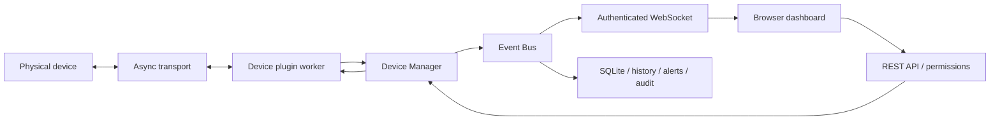

# Stage Monitor

**A modular monitoring and control dashboard for live events, stages and production teams.**

Stage Monitor brings RF receivers, IEM transmitters, cameras, network equipment, DMX gateways, power meters and playback tools into one browser dashboard. It is intended for FOH, stage, audio, video and network operators who need current device information and a common place to coordinate a show.

The Python backend exposes REST and WebSocket APIs. The HTML/CSS/JavaScript frontend is a separate layer, served by the backend for a simple local installation. Manufacturer protocols live in device plugins, not in the application core.

## Features

- **Device monitoring:** live status, identity, metrics, parameters, data quality and last contact; supervised reconnects and per-device failure isolation.
- **Logical controls:** validated commands with roles, device scopes, revision checks, idempotency keys and explicit confirmed/uncertain results.
- **Compact dashboard:** collapsed/expanded columns, configurable visible features, RF/audio meters, short metric history, pinning and horizontal wheel navigation. The bottom scrollbar has its own reserved lane.
- **Alerts and rules:** thresholds, hold/clear delays, hysteresis, active/acknowledged/resolved states, operator acknowledgements and history.
- **Team chat:** channels, direct conversations, presence, unread counts, typing indicators, grouped consecutive messages and optional critical alarm notices.
- **Show profiles:** event-specific device assignments and weather location; pause unused devices without deleting configuration or history.
- **Presets and history:** declared restorable parameters, configuration snapshots, difference previews, operation results, a shared timeline and audit records.
- **Organization:** tags, groups, rack/location/notes, inventory fields and upstream device/port dependencies.
- **Diagnostics and storage:** worker/queue health, bounded traces, connection tests, SQLite history with sampling/retention and configuration backup/restore.
- **Weather:** Open-Meteo current/hourly data and locally derived wind/rain/storm alerts, with a compact current-conditions tile and expanded Windy map. These are not official severe-weather warnings.
- **Camera preview:** an optional local NDI/RTSP-to-WebRTC media layer. Video is separate from telemetry.
- **Configurable OSC:** an editor for statuses, trigger/momentary/toggle controls, sliders, vertical/horizontal meters, feedback, message learning, tests and mapping presets.
- **Languages and themes:** English source/default language, Polish translation, editable language packs, per-plugin translations and CSS theme packages.

Device categories are data, not a fixed core enum. A new category or adapter does not require manufacturer code in the core.

## Integrations

The [plugin catalog](docs/plugins/README.md) contains individual setup guides, configuration reference, telemetry, commands and limitations. The catalog lists **14 production device adapters**.

| Integration | Plugin ID | Purpose |
| --- | --- | --- |
| Shure QLX-D / QLXD4 | `shure.qlxd` | Receiver telemetry; optional frequency/gain control |
| Shure SLX-D / SLXD4 / SLXD4D | `shure.slxd` | RF/audio/battery telemetry; optional frequency/gain control |
| Sennheiser SR IEM G4 | `sennheiser.iem_g4` | IEM transmitter monitoring |
| OBSBOT Tail Air | `obsbot.tail_air` | VISCA state, optional PTZ/presets, portal telemetry and preview metadata |
| MikroTik CRS326 | `mikrotik.crs326` | RouterOS resources, traffic and ports |
| MikroTik RouterOS 7 | `mikrotik.routeros` | Basic network/resource summary |
| OpenWrt | `openwrt.ubus` | Read-only uptime, memory, system load and interface statistics |
| NETRON EN12 | `netron.en12` | Gateway and DMX port monitoring |
| Phoenix Contact EEM-MA370 | `phoenix.eem_ma370` | Read-only Modbus TCP power measurements |
| NUT UPS | `nut.ups` | Read-only UPS status, battery, load and voltage via Network UPS Tools |
| Denon SC6000 | `denon.sc6000` | Read-only StageLinQ deck state/metadata |
| OBS Wave Player | `obs.wave_player` | Playback/library control, state and audio meters |
| Generic RTSP | `generic.rtsp` | Camera preview through the media layer |
| Generic OSC | `generic.osc` | User-defined UDP feedback and controls |

Support is adapter-specific. Protocol fixture tests are not hardware certification. In particular, SC6000 and EEM-MA370 require confirmation on the intended hardware/firmware. Shure ULX-D, dbx DriveRack PA2 and Showtec NET-8/3 are not advertised as supported by the current adapter list.

## Quick start

Python **3.12+** is required. Windows is the primary deployment target, including Windows Credential Manager for saved device passwords. Use a source checkout with an editable installation; the dashboard lives alongside the backend source.

```powershell
git clone https://github.com/Vampir8/stage-monitor.git
cd stage-monitor\backend
py -3.12 -m venv .venv
.\.venv\Scripts\python.exe -m pip install --upgrade pip
.\.venv\Scripts\python.exe -m pip install -e ".[dev]"
.\.venv\Scripts\python.exe -m stage_monitor
```

On first start, the launcher asks for an administrator password of 12–256 characters. There is no default published password. Later starts use the existing database.

Open [the dashboard](http://localhost:8000/) and sign in as `admin`. Add equipment through **Devices → Add device**. The published application starts without demo devices. OpenAPI is available at [`/docs`](http://localhost:8000/docs).

Optional extras, from the backend directory:

```powershell
.\.venv\Scripts\python.exe -m pip install -e ".[serial,modbus]"
.\.venv\Scripts\python.exe -m pip install -e ".[video]"
```

NDI requires a separately installed NDI Runtime; native runtime binaries are not redistributed. See [camera preview](docs/media.md).

## Architecture



Each device has a supervised worker process. Manufacturer parsers and encoders run there; an adapter failure does not take down unrelated devices. Plugins are trusted code, not sandboxed scripts. Core owns permissions, command admission, lifecycle, persistence and events. Video uses a separate media path.

Run one backend instance per SQLite data directory. Do not run multiple Uvicorn API workers against the same database or expose device control directly to the Internet.

## Documentation

- [Installation, configuration and operations](docs/operations.md)
- [Plugin catalog and individual device guides](docs/plugins/README.md)
- [Plugin SDK: write your own adapter](docs/plugin-sdk.md)
- [Complete HTTP adapter example](examples/plugins/http_sensor/README.md)
- [REST/WebSocket API](docs/api.md)
- [Camera preview](docs/media.md)
- [Languages and plugin dictionaries](docs/languages.md)
- [Contributing](CONTRIBUTING.md)

## Status and attribution

This is an evolving live-event tool, not a replacement for manufacturer control software, an electrical safety system or an official weather warning service. Verify command behavior and hardware/network failure recovery before relying on an adapter during a show. Uncertain commands are deliberately not reported as completed.

No project-wide license has been selected yet. The included Cascadia Code font has its own [SIL Open Font License](docs/CascadiaCode-LICENSE.txt). Manufacturer names identify compatible equipment; no affiliation or certification is implied.
